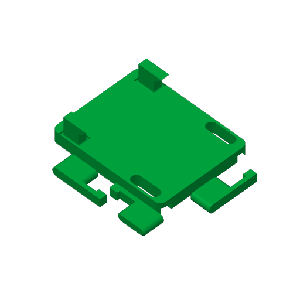
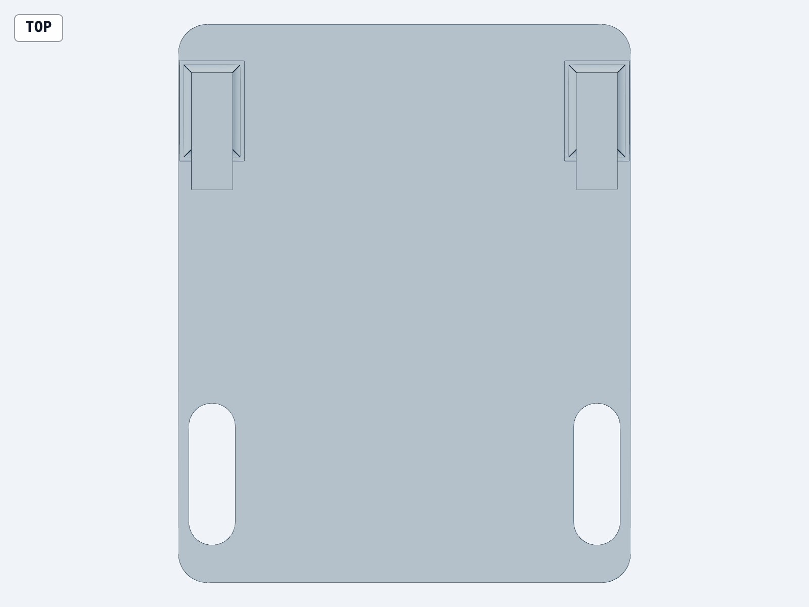

# Adaptador SKÅDIS para el soporte del mando

<p align="center"></p>

Pieza impresa en 3D para colgar en un tablero IKEA SKÅDIS el soporte de pared del mando de mi ventilador de techo con luz. El soporte original no se toca: se atornilla al adaptador con sus mismos dos tornillos, y el adaptador se engancha al tablero.

> [!WARNING]
> El diseño está a medio pulir. Lo uso a diario, pero a veces se sale del tablero. Si lo imprimes, cuenta con tener que ajustarlo.

```text
   tablero SKÅDIS          adaptador impreso          soporte original
  ┌──────────────┐       ┌──────────────────┐       ┌─────────────────┐
  │  ▯    ▯    ▯ │ ◄──── │ 2 ganchos arriba │ ◄──── │ sus 2 tornillos │ ◄──── mando
  │  ▯    ▯    ▯ │       │ 2 tapones abajo  │       │                 │
  └──────────────┘       └──────────────────┘       └─────────────────┘
```

## Cómo se hizo

Lo diseñó un agente de código a partir de una descripción en texto ([CLAUDE.md](CLAUDE.md)) y unas fotos acotadas de la pieza original ([reference/](reference/)), usando las skills de CAD de [earthtojake/text-to-cad](https://github.com/earthtojake/text-to-cad). El modelo es paramétrico en build123d: se cambia una cota, se regenera y se vuelve a imprimir. Las tres versiones salieron el mismo día.

## Imprimir

En `models/<versión>/print/` hay un proyecto de Bambu Studio ya laminado para la A1 mini: PLA Basic, capa de 0.2 mm, 4 perímetros, relleno del 15 % y sin soportes. La v0.3 son la placa y los tapones de bloqueo, 1 h 35 min en total.

Para otra impresora, usa los `.stl` o `.3mf` de la carpeta de cada versión.

## Montaje (v0.3)

<p align="center"></p>

1. Cuelga la placa en la fila de slots de arriba y déjala caer hasta el tope.
2. Mete un tapón por cada ventana, empujando de frente hasta que el tirador quede plano en la ranura. Ahora la placa no puede subir.
3. Atornilla el soporte del mando a la placa con dos tornillos de 8 mm como mucho.

Para descolgarlo: quita los dos tornillos, saca los tapones tirando del tirador y levanta la placa. Con el soporte puesto los tapones no salen, porque su trasera les tapa el recorrido. Eso es justo lo que impide que se suelte solo.

## Versiones

| Versión | Estado | Cambios |
|---|---|---|
| v0.1 | superada | Primer prototipo. Placa 46×58×5. 4 ganchos, vástago de 4 mm, labio a 45°. 17 cm³, 1 h 09 min. |
| v0.2 | superada | Repisa de anclaje recta de 1.2 mm antes de la rampa (el labio a 45° se descabalgaba al tirar). Vástago de 4 a 8 mm. Placa de 5 a 6 mm. 17.2 cm³, 1 h 21 min. |
| v0.3 | **en uso**, a veces se sale | Se sacaba tirando del mando hacia arriba. Ahora son dos piezas: la fila de ganchos de abajo pasa a ser dos ventanas con **tapón de bloqueo**, que rellena el slot y deja la subida en 0.9 mm en vez de 4.2. Corrige además dos errores de v0.1 y v0.2. 16.6 cm³, 1 h 35 min. |

### Errores de v0.1 y v0.2 corregidos en v0.3

1. **El redondeo de la raíz separaba la placa del panel.** Un fillet de 0.8 mm ensancha el gancho a 5.9 mm en la base, y el slot mide 5 mm: la placa quedaba 0.8 mm por delante del panel. La v0.3 hunde cada gancho en un rebaje de alivio para que el fillet quede por debajo del plano de contacto.
2. **Los extremos de los slots son semicirculares (r = 2.5).** Un gancho recto de 4.3 mm de ancho no llega al fondo del slot y se apoya 1.22 mm más arriba. Sin tenerlo en cuenta, la ventana del tapón quedaba desalineada más que su holgura.

## Estructura

```text
models/<versión>/
  skadis_params.py                todos los parámetros (v0.3 en adelante; se edita aquí)
  skadis_remote_adapter.step.py   la placa
  skadis_lock_plug.step.py        el tapón de bloqueo, se imprimen 2 (v0.3 en adelante)
  assembly_check.step.py          placa + tapones + panel, solo para comprobar
  *.step / *.stl / *.3mf / *.glb  modelos exportados
  snapshots/                      vistas renderizadas
  print/                          proyecto de Bambu Studio laminado
reference/                        vistas y cotas de la pieza original
```

## Regenerar

Las skills de CAD no van en el repo. Instálalas con `npx skills add earthtojake/text-to-cad` (las versiones usadas están en `skills-lock.json`) y crea un `.venv` con las dependencias de la skill `cad`.

```bash
V=v0.3
for P in skadis_remote_adapter skadis_lock_plug; do
  .venv/bin/python models/$V/$P.step.py        # auto-chequeo
  .venv/bin/python .claude/skills/cad/scripts/gen models/$V/$P.step.py --write --force
  .venv/bin/python .claude/skills/cad/scripts/export models/$V/$P.step.py --stl --3mf --glb
done
```

## Geometría SKÅDIS usada

Comprobada midiendo el panel y contra [franpoli/OpenSCADutil](https://github.com/franpoli/OpenSCADutil/blob/master/libraries/ikea_skadis_pegboard_accessories/ikea_skadis.scad), la librería de referencia para accesorios SKÅDIS.

- Slot: 5 × 15 mm, vertical, con los extremos redondeados.
- Paso horizontal entre slots a la **misma altura**: 40 mm.
- Paso vertical dentro de una columna: 40 mm.
- La rejilla tiene columnas intercaladas cada 20 mm y bajadas 20 mm, que no se usan.
- Grosor del panel: 5.0 mm (el estándar de IKEA, sin medir).
